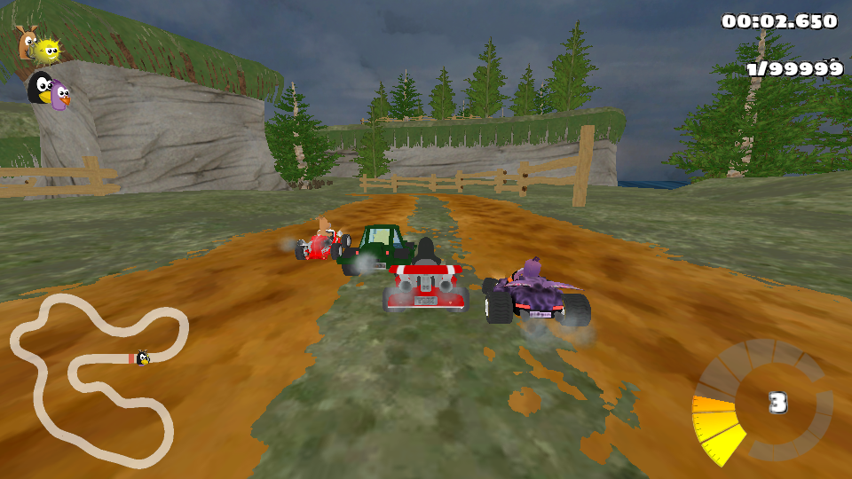

# Захват кадра: SuperTuxKart / Vulkan / RenderDoc

Готовый мини-отчёт по [заданию capture](https://github.com/Mrkol/graphics-course/blob/master/tasks/capture/README.md) курса графики.

**[Открыть отчёт в PDF](output/pdf/capture_report.pdf)** · **[Скачать исходный захват](https://github.com/Dreaaammy/graphics-capture/releases/tag/report-v1)**

Автор работы: **Dreaaammy**. Дата отчёта: **14.10.2026**.



## Что выполнено

| Пункт задания | Результат |
| --- | --- |
| Захват кадра 3D-игры | SuperTuxKart 1.4, Vulkan, Lighthouse, четыре карта; RenderDoc, кадр 80, 960 × 540. |
| Порядок отрисовки | Один render pass: opaque → alpha-test → поздний skybox → прозрачность → HUD → present. В PDF показаны промежуточные картинки и EID. |
| Геометрия сцены | Indexed TriangleList, vertex/index buffers, post-VS выгрузка, упаковка атрибутов, инстансинг и camera UBO. |
| Данные инструментов RenderDoc | События, pipeline, depth/blend state, текстуры/mips/slices, ресурсы, mesh/buffers, reflection и шейдеры исследованы через Replay API. |
| Байткод | Извлечены 10 настоящих SPIR-V модулей; приложены disassembly RenderDoc и spirv-dis. В PDF разобраны выборка текстуры, alpha-test, InstanceIndex и skybox. |
| Изменение шейдера | Реальная замена FS 206 в replay: изменились 207 889 пикселей; после отмены исходный RGBA-кадр восстановился побайтово. |
| Иллюстрированный отчёт | Пятистраничный PDF с изображениями из захвата, таблицами и объяснениями. |

В README задания нет отдельных бонусных пунктов или формальной шкалы дополнительных баллов. Здесь выполнен и эксперимент с редактированием шейдера; оценку определяет преподаватель.

### Важные ограничения метода

- Это настоящий процесс игры, инъекция RenderDoc и настоящий `.rdc`, не имитация сцены и не картинки из интернета.
- Запуск сделан удалённо в GitHub Actions: Debian 12, RenderDoc 1.24, SuperTuxKart 1.4 и программный Vulkan-драйвер Mesa lavapipe. На Mac не устанавливались виртуальная машина или игра. По этому запуску нельзя оценивать скорость игровой GPU.
- GUI RenderDoc не автоматизировался: данные окон исследованы с помощью официального Python Replay API. Иллюстрации честно подписаны как экспорты или визуализации данных, а не скриншоты интерфейса.
- Используется Vulkan-бэкенд игры 1.4. В данном захвате нет отдельных SSAO, bloom, shadow-map или deferred-проходов. Флаги запуска этих эффектов не использованы как доказательство их присутствия.
- Автоматическая гонка использует `--profile-time=180 --seed=42`; поэтому HUD показывает 99999 кругов. Это штатный режим профилировщика игры.

## Материалы для проверки

- [manifest.json](evidence/vulkan/manifest.json): SHA-256 `.rdc`, кадр, ресурсы, текстуры и actionable events.
- [analysis.json](evidence/vulkan/analysis.json): состояния всех 116 draw calls и reflection 10 модулей.
- [mesh.json](evidence/vulkan/mesh.json): индексы и post-VS позиции выбранной наглядной сетки; соседние `mesh_e*.json` позволяют сравнить другие объекты.
- [constants.json](evidence/vulkan/constants.json): настоящие значения camera UBO.
- [resource_usage.json](evidence/vulkan/resource_usage.json): история использования color/depth ресурсов.
- [shader_experiment.json](evidence/vulkan/shader_experiment.json): затронутые события, число изменённых пикселей, хеши и проверка отката.
- [Текстуры, кадры и шейдеры](evidence/vulkan/): PNG, исходные SPIR-V, `.spvasm` и человекочитаемый disassembly.
- [Исходный захват](https://github.com/Dreaaammy/graphics-capture/releases/tag/report-v1): архив с `.rdc`, не требующий Git LFS. Его SHA-256: `ec811c7fe011a5527a58b5b83cd9e369292c85eeea36cd7d37a473873aabbbe8`.

## Воспроизведение без виртуалки на Mac

1. Открой [Actions](https://github.com/Dreaaammy/graphics-capture/actions/workflows/capture.yml).
2. Выбери **Run workflow**. Renderer по умолчанию - **vulkan**.
3. Оставь `capture_run_id` пустым для нового запуска игры и нового захвата. Linux и все программы устанавливаются на удалённом одноразовом раннере.
4. После зелёного результата скачай `game-capture-vulkan` (картинки и анализ) или `raw-capture-vulkan` (включая `.rdc`). Для повторного анализа такого захвата можно указать номер этого запуска в `capture_run_id`.

Данные в отчёте получены из [захвата](https://github.com/Dreaaammy/graphics-capture/actions/runs/38467806756) и повторного воспроизведения на том же программном Vulkan-драйвере. История первоначальной настройки, включая ошибки совместимости SDK 1.24, сохранена; ошибочные запуски не выдаются за успешные проверки.

Чтобы проверить `.rdc` вручную на Linux/Windows с RenderDoc: **File → Open Capture**, затем выбери EID 49 (opaque), 143 (alpha-test), 166 (skybox), 173 (96 экземпляров quad) или 205 (HUD). Открой Pipeline State, Texture Viewer, Mesh Viewer и Shader Viewer. На macOS нативного Vulkan replay RenderDoc нет.

### Пересборка PDF и локальные проверки

Нужны Python, зависимости ниже и свободные шрифты DejaVu. На Linux папка шрифтов обычно `/usr/share/fonts/truetype/dejavu`.

```sh
python -m pip install -r requirements-report.txt
python scripts/build_report.py --font-dir /путь/к/dejavu
python scripts/check_report.py
```

Отдельный workflow проверяет приложенный PDF, SPIR-V, JSON, число изменённых пикселей и восстановленный кадр, затем независимо пересобирает PDF на Linux. Это проверки материалов отчёта, а не скрытый автогрейдер курса.

## Источники и права

- [Условие задания](https://github.com/Mrkol/graphics-course/blob/master/tasks/capture/README.md).
- [RenderDoc и официальные примеры Replay API 1.24](https://github.com/baldurk/renderdoc/tree/v1.24/docs/python_api/examples/renderdoc).
- [SuperTuxKart 1.4](https://github.com/supertuxkart/stk-code/tree/1.4), [авторы игры и ассетов](https://github.com/supertuxkart/stk-code/blob/1.4/data/CREDITS), [лицензии игры и данных](https://github.com/supertuxkart/stk-code/blob/1.4/COPYING).
- [Mesa llvmpipe](https://docs.mesa3d.org/drivers/llvmpipe.html).

Картинки, модели, текстуры и шейдеры игры принадлежат авторам SuperTuxKart и опубликованы для учебного разбора со ссылками на исходники и сведения о лицензиях. Они не объявляются оригинальными ассетами автора отчёта. Скрипты анализа и текст отчёта написаны для этой работы; чужие студенческие решения не использовались.

Для сдачи достаточно отправить PDF или ссылку на него. Pull request по условию этой задачи не нужен; репозиторий отчёта **публичный**, прежний репозиторий с домашками не менялся.
